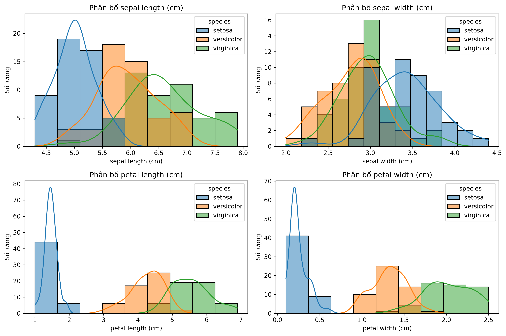
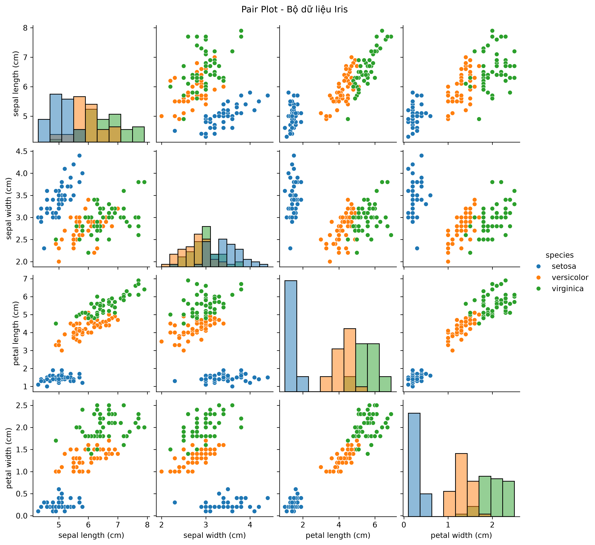
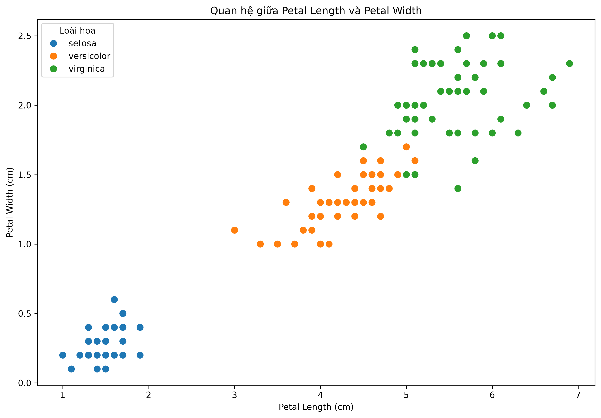

# BÁO CÁO ĐỒ ÁN

## XÂY DỰNG VÀ TRIỂN KHAI HỆ THỐNG PHÂN LOẠI HOA IRIS BẰNG SVM

**Sinh viên:** Đoàn Công Bảo Hiếu  
**Lớp:** 24CKDL  
**Giảng viên hướng dẫn:** Phan Trần Đức Minh  
**Đơn vị:** Trường Đại học Sư phạm - Đại học Đà Nẵng  
**Thời gian:** Tháng 11 năm 2026

---

## Tóm tắt

Đồ án xây dựng một hệ thống web phân loại hoa Iris dựa trên bốn số đo hình thái. Trọng tâm là mô hình Support Vector Machine (SVM); ngoài ra, hệ thống cho phép đối chiếu kết quả với K-Nearest Neighbors, Decision Tree, Random Forest và Logistic Regression. Bộ dữ liệu Iris có 150 mẫu, bốn đặc trưng và ba lớp.

Quy trình đánh giá sử dụng phép chia phân tầng 80/20 với `random_state=42`. Grid Search với kiểm định chéo 5 phần trên tập huấn luyện chọn SVM tuyến tính với `C=0.1`. Trên tập kiểm tra gồm 30 mẫu, mô hình đạt accuracy 93,33% (28/30 dự đoán đúng). Sau khi đánh giá, các mô hình được huấn luyện lại trên đủ 150 mẫu và lưu thành tệp để ứng dụng tải khi khởi động.

**Từ khóa:** Iris, học máy, phân loại, SVM, FastAPI, scikit-learn, triển khai web.

## Mục lục

1. [Giới thiệu](#1-giới-thiệu)
2. [Cơ sở lý thuyết mô hình SVM](#2-cơ-sở-lý-thuyết-mô-hình-svm)
3. [Dữ liệu và trực quan hóa](#3-dữ-liệu-và-trực-quan-hóa)
4. [Huấn luyện và đánh giá SVM](#4-huấn-luyện-và-đánh-giá-svm)
5. [Công nghệ sử dụng để triển khai trực tuyến](#5-công-nghệ-sử-dụng-để-triển-khai-trực-tuyến)
6. [Quy trình triển khai và vận hành](#6-quy-trình-triển-khai-và-vận-hành)
7. [Demo hệ thống](#7-demo-hệ-thống)
8. [Kết luận và hướng phát triển](#8-kết-luận-và-hướng-phát-triển)
9. [Phụ lục: mã Python](#9-phụ-lục-mã-python)

---

## 1. Giới thiệu

### 1.1. Bối cảnh

Phân loại là một bài toán học máy có giám sát: từ các ví dụ đã biết nhãn, mô hình học quy luật để dự đoán nhãn của mẫu mới. Bộ dữ liệu Iris là bộ dữ liệu chuẩn thường dùng để minh họa bài toán phân loại nhiều lớp. Bài toán trong đồ án là dự đoán một mẫu hoa thuộc loài Setosa, Versicolor hay Virginica dựa trên chiều dài và chiều rộng đài hoa, chiều dài và chiều rộng cánh hoa.

### 1.2. Mục tiêu

- Tìm hiểu nguyên lý của SVM và áp dụng SVM tuyến tính vào bài toán phân loại Iris.
- Chuẩn hóa dữ liệu, lựa chọn tham số và đánh giá mô hình trên dữ liệu chưa dùng khi huấn luyện.
- Xây dựng giao diện web cho phép nhập số đo, chọn mô hình và xem kết quả dự đoán.
- Cung cấp API để giao diện gửi yêu cầu dự đoán đến backend.
- Lưu mô hình đã huấn luyện để backend tải lại, thay vì huấn luyện mô hình mỗi lần khởi động.

### 1.3. Phạm vi

Ứng dụng hiện hỗ trợ năm bộ phân loại: SVM, KNN, Decision Tree, Random Forest và Logistic Regression. SVM là mô hình trọng tâm của báo cáo. Dữ liệu thực nghiệm là Iris có sẵn trong scikit-learn; kết quả không đại diện cho dữ liệu hoa thu thập ngoài thực tế.

---

## 2. Cơ sở lý thuyết mô hình SVM

### 2.1. Ý tưởng phân loại

Support Vector Machine tìm một siêu phẳng để phân chia các lớp. Với dữ liệu hai lớp, siêu phẳng có dạng:

`wᵀx + b = 0`

Trong đó `x` là vector đặc trưng, `w` xác định hướng của siêu phẳng và `b` là độ lệch. SVM tìm ranh giới sao cho khoảng cách đến các điểm dữ liệu gần ranh giới nhất được tối đa hóa. Các điểm gần ranh giới, có ảnh hưởng quyết định đến nó, được gọi là **support vectors** (véc-tơ hỗ trợ).

### 2.2. Biên và tham số C

Không phải lúc nào dữ liệu cũng phân tách hoàn hảo. Tham số `C` điều chỉnh mức phạt đối với các điểm bị phân loại sai:

- `C` lớn ưu tiên giảm lỗi trên dữ liệu huấn luyện, nhưng có thể tạo ranh giới nhạy với dữ liệu.
- `C` nhỏ cho phép một số lỗi để duy trì biên rộng và khả năng khái quát hóa tốt hơn.

Trong thí nghiệm này, Grid Search chọn `C=0.1` cho kernel tuyến tính.

### 2.3. Kernel

Kernel cho phép SVM xây dựng ranh giới phi tuyến bằng cách tính quan hệ giữa các điểm trong không gian đặc trưng mà không cần biểu diễn tường minh không gian đó. Script tối ưu thử các kernel tuyến tính (`linear`), RBF (`rbf`) và đa thức (`poly`). Cấu hình tốt nhất trên tập huấn luyện là kernel tuyến tính.

Với bài toán nhiều lớp, `SVC` của scikit-learn kết hợp các bộ phân loại nhị phân theo chiến lược one-vs-one.

### 2.4. Chuẩn hóa đặc trưng

Bốn phép đo có thể có độ lớn và độ phân tán khác nhau. `StandardScaler` chuẩn hóa mỗi đặc trưng dựa trên trung bình và độ lệch chuẩn của tập huấn luyện. Scaler được đặt cùng SVM trong một `Pipeline`, nhờ đó trong từng fold kiểm định, bước chuẩn hóa chỉ được fit trên phần huấn luyện tương ứng, giảm rò rỉ dữ liệu.

---

## 3. Dữ liệu và trực quan hóa

### 3.1. Mô tả dữ liệu

| Thuộc tính | Giá trị |
|---|---:|
| Tổng số mẫu | 150 |
| Số đặc trưng | 4 |
| Số lớp | 3 |
| Số mẫu mỗi lớp | 50 |

| Đặc trưng | Ý nghĩa |
|---|---|
| `sepal length` | Chiều dài đài hoa (cm) |
| `sepal width` | Chiều rộng đài hoa (cm) |
| `petal length` | Chiều dài cánh hoa (cm) |
| `petal width` | Chiều rộng cánh hoa (cm) |

Các nhãn được mã hóa thành 0, 1, 2 tương ứng với Setosa, Versicolor và Virginica. Bộ dữ liệu được nạp bằng `sklearn.datasets.load_iris()`.

### 3.2. Khám phá và trực quan hóa

Các hình dưới đây là biểu đồ đã có trong thư mục `reports/` của dự án.

**Phân bố các đặc trưng**



**Quan hệ cặp giữa các đặc trưng**



**Phân tán các đặc trưng cánh hoa**



Nhìn chung, hai đặc trưng cánh hoa thể hiện khả năng tách lớp rõ hơn; Setosa đặc biệt dễ phân biệt. Versicolor và Virginica có vùng giá trị chồng lấn, nên là nguồn của các nhầm lẫn còn lại trong kết quả kiểm tra.

### 3.3. Chia tập dữ liệu

`train_test_split` dùng `test_size=0.2`, `stratify=y` và `random_state=42`. Kết quả là 120 mẫu huấn luyện và 30 mẫu kiểm tra; mỗi lớp có 40 mẫu huấn luyện và 10 mẫu kiểm tra. Tập kiểm tra chỉ được dùng để đánh giá, không dùng để chọn tham số.

---

## 4. Huấn luyện và đánh giá SVM

### 4.1. Quy trình

1. Nạp bộ Iris.
2. Chia phân tầng thành tập huấn luyện và tập kiểm tra theo tỷ lệ 80/20.
3. Tạo pipeline `StandardScaler` + `SVC`.
4. Dùng `GridSearchCV` với `StratifiedKFold` 5 phần trên tập huấn luyện. Grid Search thử các kernel và tham số `C`, `gamma`, `degree` được định nghĩa trong `backend/optimize_svm.py`.
5. Chọn cấu hình theo accuracy trung bình trên các fold.
6. Đánh giá cấu hình được chọn trên tập kiểm tra độc lập.
7. Sau đánh giá, huấn luyện lại pipeline trên toàn bộ 150 mẫu và lưu mô hình triển khai.

Grid Search được chạy lại trong môi trường dự án; kết quả cấu hình tốt nhất là `kernel='linear'`, `C=0.1`, với accuracy CV 0.9750.

### 4.2. Kết quả trên tập kiểm tra

| Chỉ số | Giá trị |
|---|---:|
| Số mẫu kiểm tra | 30 |
| Dự đoán đúng | 28/30 |
| Accuracy | 93,33% |
| Precision (weighted) | 93,33% |
| Recall (weighted) | 93,33% |
| F1-score (weighted) | 93,33% |

**Ma trận nhầm lẫn** (hàng là nhãn thật, cột là nhãn dự đoán):

| Thực tế \ Dự đoán | Setosa | Versicolor | Virginica |
|---|---:|---:|---:|
| Setosa | 10 | 0 | 0 |
| Versicolor | 0 | 9 | 1 |
| Virginica | 0 | 1 | 9 |

Setosa được phân loại đúng cả 10 mẫu. Một mẫu Versicolor bị dự đoán thành Virginica và một mẫu Virginica bị dự đoán thành Versicolor. Kết quả phản ánh vùng đặc trưng của hai loài này có phần chồng lấn.

### 4.3. Kiểm định chéo và ý nghĩa

Kiểm định chéo 5 phần được thực hiện trên **120 mẫu huấn luyện**, không gộp tập kiểm tra vào quá trình lựa chọn tham số. Các accuracy theo fold là 95,83%, 100,00%, 95,83%, 95,83% và 100,00%; trung bình **97,50%**, độ lệch chuẩn **2,04%**.

Accuracy CV và accuracy kiểm tra đo trên các tập khác nhau nên không cần bằng nhau. Con số 97,50% không phải kết quả trên tập kiểm tra; chỉ số trên tập kiểm tra là 93,33%.

### 4.4. So sánh năm mô hình

Các cấu hình hiện tại được đánh giá trên cùng phép chia 80/20, sau đó được fit lại trên toàn bộ dữ liệu để dùng khi dự đoán.

| Mô hình | Accuracy | Precision (weighted) | Recall (weighted) | F1 (weighted) |
|---|---:|---:|---:|---:|
| SVM tuyến tính (`C=0.1`) | 93,33% | 93,33% | 93,33% | 93,33% |
| KNN (`k=5`) | 93,33% | 94,44% | 93,33% | 93,27% |
| Decision Tree | 93,33% | 93,33% | 93,33% | 93,33% |
| Random Forest (`100` cây) | 90,00% | 90,24% | 90,00% | 89,97% |
| Logistic Regression | 93,33% | 93,33% | 93,33% | 93,33% |

Các số liệu trên là kết quả của một phép chia train/test cố định, không chứng minh mô hình nào luôn tốt nhất trên dữ liệu mới. Với bộ Iris nhỏ, nên xem thêm cross-validation hoặc đánh giá trên dữ liệu độc lập trước khi khái quát kết luận.

---

## 5. Công nghệ sử dụng để triển khai trực tuyến

| Thành phần | Công nghệ | Vai trò |
|---|---|---|
| Giao diện | HTML, CSS, JavaScript | Hiển thị thông tin, nhận thông số và gửi yêu cầu dự đoán |
| Backend/API | Python, FastAPI | Kiểm tra dữ liệu đầu vào, gọi mô hình và trả JSON |
| Mô hình | scikit-learn | Pipeline, chuẩn hóa và các thuật toán phân loại |
| Lưu/đọc mô hình | Joblib | Lưu pipeline đã fit vào các tệp `.pkl` |
| Cơ sở dữ liệu | SQLAlchemy; cấu hình PostgreSQL qua `DATABASE_URL`, SQL Server cục bộ hoặc SQLite dự phòng | Lưu tài khoản và lịch sử dự đoán |
| Máy chủ ứng dụng | Uvicorn | Chạy ứng dụng ASGI FastAPI |
| Hosting được cấu hình trong mã | Render | Domain frontend/backend được tham chiếu bởi mã nguồn |
| Quản lý mã nguồn | Git và GitHub | Lưu mã nguồn, hỗ trợ đưa thay đổi lên môi trường triển khai |

Mã frontend hiện trỏ API production đến `https://iris-svm-api-oar1.onrender.com`; frontend được cấu hình CORS trong backend là `https://iris-svm-frontend-alrz.onrender.com`. Đây là các địa chỉ được ghi trong mã nguồn, không phải xác nhận trạng thái hoạt động trực tiếp của dịch vụ tại thời điểm đọc báo cáo.

---

## 6. Quy trình triển khai và vận hành

### 6.1. Kiến trúc

```text
Trình duyệt
    │ nhập bốn số đo và chọn mô hình
    ▼
Frontend HTML/CSS/JavaScript
    │ POST /predict (JSON)
    ▼
FastAPI trên backend
    │ tải pipeline đã lưu và gọi predict()
    ▼
Các tệp model/*.pkl
    │
    └── JSON kết quả → frontend hiển thị tên loài, mô hình và thời gian dự đoán

FastAPI ── SQLAlchemy ── cơ sở dữ liệu (tài khoản/lịch sử nếu có cấu hình user_id)
```

### 6.2. Huấn luyện và đóng gói mô hình

Từ thư mục gốc dự án, chạy:

```powershell
.\.venv\Scripts\python.exe .\backend\train_models.py
```

Script đánh giá các mô hình trên phép chia cố định, in chỉ số, rồi fit lại từng bộ phân loại trên đủ 150 mẫu. Các pipeline được lưu trong thư mục `model/`:

- `iris_svm_model.pkl`
- `iris_knn_model.pkl`
- `iris_tree_model.pkl`
- `iris_random_forest_model.pkl`
- `iris_logistic_model.pkl`

Các tệp mô hình là thành phần cần thiết để backend khởi động. Khi cập nhật mô hình, cần đưa cả tệp `.pkl` mới lên môi trường backend cùng với mã tương ứng; nếu thiếu tệp, backend sẽ báo lỗi rõ ràng thay vì tự huấn luyện khi khởi động.

### 6.3. Chạy ứng dụng cục bộ

1. Cài các thư viện được liệt kê trong `requirements.txt` vào môi trường Python.
2. Sinh các tệp mô hình bằng lệnh ở mục 6.2 nếu chưa có.
3. Khởi chạy backend:

   ```powershell
   .\.venv\Scripts\python.exe -m uvicorn backend.app:app --host 127.0.0.1 --port 8000
   ```

4. Mở giao diện `frontend/index.html` qua máy chủ web tĩnh ở `localhost:5500` hoặc `127.0.0.1:5500`. Mã frontend đã cho phép hai origin này và tự chọn API cục bộ `http://127.0.0.1:8000`.
5. Có thể mở `http://127.0.0.1:8000/docs` để xem và thử API bằng Swagger UI.

### 6.4. Triển khai trực tuyến

Theo các domain được cấu hình trong source, kiến trúc triển khai dự kiến tách frontend và backend thành hai dịch vụ:

1. Đẩy mã nguồn, script huấn luyện và các tệp mô hình cần thiết lên GitHub.
2. Tạo/cập nhật dịch vụ backend từ repository, cài dependencies và cấu hình lệnh chạy Uvicorn phù hợp với cổng do nền tảng cung cấp.
3. Đưa biến môi trường `DATABASE_URL` vào cấu hình dịch vụ nếu dùng cơ sở dữ liệu ngoài; không ghi thông tin kết nối hoặc mật khẩu trực tiếp vào mã nguồn.
4. Triển khai frontend tĩnh và cấu hình API URL production trỏ đến backend.
5. Đảm bảo domain frontend khớp với danh sách CORS của backend.
6. Kiểm tra endpoint gốc, `/docs`, kết nối cơ sở dữ liệu nếu sử dụng và một yêu cầu `/predict`.

Repository hiện không có tệp cấu hình tự động hóa triển khai như `render.yaml`; do đó, build/start command, biến môi trường và thông tin dịch vụ cần được xác nhận trong dashboard của nền tảng. Việc source có URL Render không tự chứng minh dịch vụ hiện đang hoạt động.

### 6.5. Vận hành và cập nhật

- Backend tải mô hình từ thư mục `model/` khi khởi động; không chạy `.fit()` trong luồng dự đoán.
- Endpoint `POST /predict` nhận bốn đặc trưng và danh sách `algorithms`. Mỗi giá trị đặc trưng phải lớn hơn 0 và không vượt quá 10.
- API trả loài dự đoán, tên thuật toán, thời gian gọi `predict()` và kết quả của các mô hình được chọn.
- Nếu gửi `user_id` hợp lệ, kết quả chính được ghi vào lịch sử; nếu không có `user_id`, dự đoán không được ghi vào lịch sử người dùng.
- Khi đổi dữ liệu, tham số, phiên bản scikit-learn hoặc cách tiền xử lý, cần huấn luyện lại, kiểm tra tương thích và triển khai đồng bộ mã với các artifact mới.
- Không nạp tệp pickle/joblib không đáng tin cậy; các tệp mô hình chỉ nên lấy từ quy trình huấn luyện và nguồn dự án được kiểm soát.

---

## 7. Demo hệ thống

### 7.1. Quy trình demo trên giao diện

1. Mở trang frontend.
2. Đến khu vực dự đoán và nhập bốn số đo hoa Iris.
3. Chọn một hoặc nhiều mô hình.
4. Nhấn nút dự đoán.
5. Quan sát tên loài, kết quả riêng của từng mô hình và thời gian dự đoán.

Ví dụ kiểm thử Setosa:

| Đặc trưng | Giá trị |
|---|---:|
| Chiều dài đài hoa | 5.1 cm |
| Chiều rộng đài hoa | 3.5 cm |
| Chiều dài cánh hoa | 1.4 cm |
| Chiều rộng cánh hoa | 0.2 cm |

Mẫu này được cả năm artifact hiện tại dự đoán là Setosa trong lần kiểm tra cục bộ.

### 7.2. Gọi API trực tiếp

```http
POST /predict
Content-Type: application/json
```

```json
{
  "algorithms": ["svm", "knn", "tree", "random_forest", "logistic"],
  "sepal_length": 5.1,
  "sepal_width": 3.5,
  "petal_length": 1.4,
  "petal_width": 0.2
}
```

Kết quả trả về chứa dự đoán chính (mô hình đầu tiên trong danh sách) và mảng `results` gồm kết quả của từng mô hình được yêu cầu.

---

## 8. Kết luận và hướng phát triển

Đồ án đã xây dựng được quy trình từ nạp dữ liệu Iris, chuẩn hóa, lựa chọn mô hình SVM bằng Grid Search, đánh giá trên tập kiểm tra đến lưu artifact và phục vụ dự đoán qua API. Cấu hình SVM tuyến tính `C=0.1` đạt 93,33% trên tập kiểm tra 30 mẫu; kiểm định chéo 5 phần trên 120 mẫu huấn luyện đạt trung bình 97,50%. Hệ thống cũng có giao diện web và hỗ trợ so sánh năm thuật toán.

Các hướng phát triển:

- Đánh giá trên tập dữ liệu độc lập lớn hơn và bổ sung báo cáo theo từng lớp.
- Lưu metadata cho mỗi artifact, như phiên bản dữ liệu, tham số và phiên bản thư viện.
- Tự động hóa kiểm thử API và quy trình triển khai.
- Bổ sung giám sát lỗi, thời gian phản hồi và tình trạng dịch vụ.
- Cải thiện quy trình quản lý secrets, cơ sở dữ liệu và xác thực khi triển khai thực tế.

---

## 9. Phụ lục: mã Python

### 9.1. Script huấn luyện, đánh giá và lưu các mô hình

Đoạn mã dưới đây là nội dung chính của `backend/train_models.py`. Script in kết quả đánh giá trên phép chia 80/20 rồi huấn luyện lại từng mô hình trên toàn bộ dữ liệu để lưu dùng khi triển khai.

```python
from pathlib import Path

import joblib
from sklearn.datasets import load_iris
from sklearn.ensemble import RandomForestClassifier
from sklearn.linear_model import LogisticRegression
from sklearn.metrics import accuracy_score, f1_score, precision_score, recall_score
from sklearn.model_selection import StratifiedKFold, cross_val_score, train_test_split
from sklearn.neighbors import KNeighborsClassifier
from sklearn.pipeline import Pipeline
from sklearn.preprocessing import StandardScaler
from sklearn.svm import SVC
from sklearn.tree import DecisionTreeClassifier


MODEL_DIR = Path(__file__).resolve().parents[1] / "model"


def create_models():
    return {
        "svm": Pipeline([
            ("scaler", StandardScaler()),
            ("classifier", SVC(kernel="linear", C=0.1))
        ]),
        "knn": Pipeline([
            ("scaler", StandardScaler()),
            ("classifier", KNeighborsClassifier(n_neighbors=5))
        ]),
        "tree": DecisionTreeClassifier(random_state=42),
        "random_forest": RandomForestClassifier(
            n_estimators=100,
            random_state=42
        ),
        "logistic": Pipeline([
            ("scaler", StandardScaler()),
            ("classifier", LogisticRegression(max_iter=1000, random_state=42))
        ])
    }


def main():
    iris = load_iris()
    X_train, X_test, y_train, y_test = train_test_split(
        iris.data,
        iris.target,
        test_size=0.2,
        random_state=42,
        stratify=iris.target
    )
    MODEL_DIR.mkdir(parents=True, exist_ok=True)

    for algorithm, estimator in create_models().items():
        estimator.fit(X_train, y_train)
        predictions = estimator.predict(X_test)
        print(
            f"{algorithm}: "
            f"accuracy={accuracy_score(y_test, predictions):.4f}, "
            f"precision={precision_score(y_test, predictions, average='weighted'):.4f}, "
            f"recall={recall_score(y_test, predictions, average='weighted'):.4f}, "
            f"f1={f1_score(y_test, predictions, average='weighted'):.4f}"
        )

        if algorithm == "svm":
            cv = StratifiedKFold(n_splits=5, shuffle=True, random_state=42)
            scores = cross_val_score(
                estimator,
                X_train,
                y_train,
                cv=cv,
                scoring="accuracy"
            )
            print(
                "svm 5-fold CV on training set: "
                f"scores={scores.tolist()}, "
                f"mean={scores.mean():.4f}, std={scores.std():.4f}"
            )

        estimator.fit(iris.data, iris.target)
        model_path = MODEL_DIR / f"iris_{algorithm}_model.pkl"
        joblib.dump(estimator, model_path)
        print(f"Đã huấn luyện lại trên đủ 150 mẫu và lưu {algorithm}: {model_path}")


if __name__ == "__main__":
    main()
```

### 9.2. Chạy Grid Search riêng cho SVM

```powershell
.\.venv\Scripts\python.exe .\backend\optimize_svm.py
```

Grid Search kiểm tra nhiều tổ hợp kernel và siêu tham số, sau đó in tham số tốt nhất, điểm CV, báo cáo phân loại và ma trận nhầm lẫn. Với phiên bản mã và phép chia dữ liệu hiện tại, cấu hình được chọn là SVM tuyến tính `C=0.1`.

### 9.3. Các tệp mã nguồn liên quan

- `backend/train_models.py`: đánh giá và lưu năm mô hình.
- `backend/train.py`: đánh giá chi tiết SVM và kiểm định chéo.
- `backend/optimize_svm.py`: Grid Search các cấu hình SVM.
- `backend/app.py`: tải artifact, cung cấp endpoint dự đoán và các endpoint ứng dụng.
- `frontend/script.js`: gửi dữ liệu dự đoán từ giao diện đến API.
- `model/`: chứa artifact `.pkl` được backend nạp.

---

**Nguồn tham khảo trong dự án**

1. Bộ dữ liệu Iris tích hợp trong `sklearn.datasets.load_iris()`.
2. Tài liệu scikit-learn về `SVC`, `Pipeline`, `StandardScaler`, `GridSearchCV` và `StratifiedKFold`.
3. Mã nguồn dự án: các script và thành phần giao diện được liệt kê trong phụ lục.
